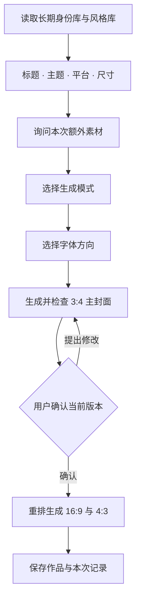

# vane-ai-blogger-cover

韦恩AI博主封面。

一个具备本地长期记忆的个人自媒体封面设计 Skill。

它把个人身份和封面视觉风格沉淀成两个持续维护的资产库。每次制作封面时，先读取这两个库，再结合本次标题、主题、平台和尺寸完成设计，让持续创作拥有稳定的个人识别和视觉语言。

## 两个长期资产

**个人身份库**保存人物外观的稳定特征、个人形象及常用视觉识别元素。生成时调用已有身份资产，让场景、姿态和服饰可以变化，同时保持人物识别。身份库已经建立且资产完整时，不重复要求初始化。

**封面视觉风格库（Cover Style Library）**把视觉偏好整理成可执行规则，覆盖八个维度：构图、标题布局、字体、色彩、背景、主视觉比例、信息层级和视觉情绪。库中既保存共同规律，也保留适合不同主题的构图分支。

每次选择都有依据：先匹配主题与素材条件，再匹配已有视觉规则和用户偏好。自由创作也以个人身份和风格锚点为基础。

## 日常工作流



| 模式 | 设计边界 |
|---|---|
| 严格参考素材 | 保留选定视觉结构，替换为本次人物、准确文案和指定内容 |
| 基于素材二次创作 | 保持身份与风格锚点，按主题重新安排场景、姿态和道具 |
| 自由创作 | 拓展场景与布局，继续遵循身份、风格体系和用户长期规则 |

字体由用户选择方向；标题逐字保留。需要改写标题时先确认文案。默认交付尺寸为1080×1440、1920×1080、1600×1200，也支持用户指定符合比例的尺寸。

主封面确认后，横版以确认作品为依据重排构图。人物、标题、配色和核心视觉保持一致，背景与元素位置适应新画幅。

## 长期记忆如何实现

记忆保存在独立的本地数据目录中。Skill 每次启动重新读取索引、分析文档和有效素材，因此能在不同聊天之间继续使用。

```text
Skill：设计流程、选择规则、存储脚本
  ↓ 读取
长期资产：身份库 + 风格库 + 历史修订
  ↓ 应用
本次任务：输入、模式、字体、提示词、作品、确认记录
```

存储脚本承担四项具体工作：

- **持久化**：复制资产并以SHA256去重，保存相对路径与索引；原来源移动后仍能读取库中副本。
- **版本管理**：分析更新生成新修订，保留历史；新增候选资产经过分析后才进入当前规则。
- **完整性检查**：读取时检查资产与分析文档，报告缺失或损坏，避免把空库当作已完成。
- **确认保护**：确认绑定当前主封面文件的哈希；主封面修改后旧确认失效，横版需要以新确认版本为依据。

用户说“以后都这样”“记住这个”“设为默认”时，才把反馈写成长期偏好。单次修改留在本次任务中。身份与风格可以分别更新。

图像理解与图片生成由运行 Skill 的助手及其图像工具完成；存储脚本负责资产和状态管理。人物一致性、中文字与精确尺寸仍需检查生成结果。跨设备继续使用时，需要迁移整个本地数据目录。

## 安装与使用

适用于可读取本地 Skill、文件并调用图片生成工具的 Codex 环境。

```sh
git clone https://github.com/VaneAi888/vane-ai-blogger-cover.git \
  "${CODEX_HOME:-$HOME/.codex}/skills/vane-ai-blogger-cover"

python3 -m pip install -r \
  "${CODEX_HOME:-$HOME/.codex}/skills/vane-ai-blogger-cover/requirements.txt"
```

在能发现新 Skill 的聊天中输入：

> 使用 $vane-ai-blogger-cover。标题：……；主题：……；平台：……；尺寸：……。

首次使用时建立缺失的资产库；已有库直接调用。默认长期数据位置：

```text
${CODEX_HOME:-~/.codex}/skill-data/vane-ai-blogger-cover/
```

可以通过存储脚本的 `--root` 参数指定其他数据目录。检查当前状态：

```sh
python3 "${CODEX_HOME:-$HOME/.codex}/skills/vane-ai-blogger-cover/scripts/library.py" status
```

## 项目文件

- [SKILL.md](SKILL.md)：初始化、日常设计与确认流程。
- [references/memory.md](references/memory.md)：长期资产结构与保存命令。
- [references/generation.md](references/generation.md)：任务简报和画幅适配规则。
- [scripts/library.py](scripts/library.py)：资产导入、修订、任务保存与确认保护。
- [tests/test_library.py](tests/test_library.py)：持久化、版本和确认保护的隔离测试。

需要Python 3.11+，运行依赖为Pillow；测试使用Python标准库unittest：

```sh
python3 -m unittest discover -s tests -v
```
